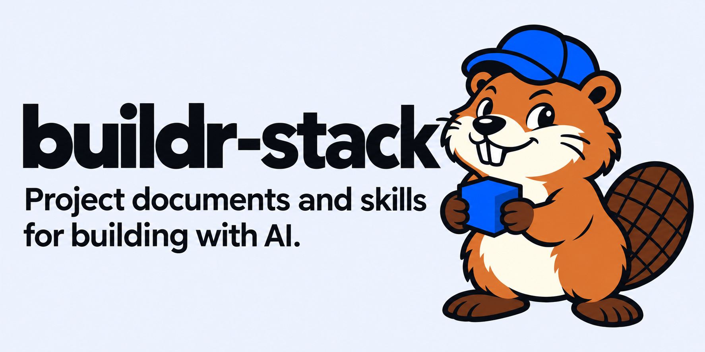

# buildr-stack

buildr-stack gives your coding agent project documents and task instructions.
Run `buildr-start` to answer questions about your project, create its folder
structure, and fill the documents.

## Start a new project

### 1. Install the starter

Clone or download this repository, then run with Python 3.10+:

```bash
python3 buildr_stack.py init ../my-project --name "My project"
```

This copies templates and skills into `my-project`. The documents contain
placeholders until you run the next step.

### 2. Manually invoke buildr-start

Open `my-project` in your coding agent. In Codex, run:

```text
$buildr-start
```

Use `/buildr-start` if your agent lists that command. Otherwise send:

```text
Use buildr-start.
```

The skill asks what you are building, who will use it, and what the first version
should do. It then asks about tools, design, constraints, and whether you want to
build directly or learn step by step. Answer in the chat.

It uses your answers to create folders, starter files, and configuration, then
fills the four project documents. It reuses the layout of an existing project.
Decisions you have not made stay marked as open questions.

### 3. Start building

Ask the agent to implement the next task in IMPLEMENTATION_PHASES.md.
Use `buildr-pair` to learn by trying each step, or set that default during
installation with `--mode pair`.

## Project documents

| File                     | Purpose                                                               |
| ------------------------ | --------------------------------------------------------------------- |
| AGENTS.md                | Agent instructions, project structure, commands, and document links   |
| PROJECT.md               | Product, scope, architecture, decisions, and progress                 |
| IMPLEMENTATION_PHASES.md | Work plan, checks, and next action                                    |
| DESIGN.md                | Visual rules, tokens, components, and references such as Paper frames |

PROJECT.md starts at v0.1. After work changes the project, `buildr-sync` updates
the relevant sections, bumps the document version, and adds a changelog entry.
Commit messages use a separate sequence, such as `v0.1: initial setup` and
`v0.2: add booking cancellation`, when you authorize commits.

To resume later, ask the agent to read the next unfinished task and its code.

## Skills

| Skill             | Use                                                                 |
| ----------------- | ------------------------------------------------------------------- |
| `buildr-start`    | Ask about the project, create its structure, and fill the documents |
| `buildr-plan`     | Plan the next two-hour work session                                 |
| `buildr-pair`     | Guide you through implementation one step at a time                 |
| `buildr-research` | Compare options using current sources                               |
| `buildr-design`   | Define the design and check that the UI matches it                  |
| `buildr-review`   | Review code changes                                                 |
| `buildr-sync`     | Update the project documents after work                             |
| `buildr-unslop`   | Remove AI writing patterns                                          |

AGENTS.md requires `buildr-unslop` for every response and written change.

## Use an existing project

Preview the installation, then add only the skills:

```bash
python3 buildr_stack.py init ../existing-project --skills-only --dry-run
python3 buildr_stack.py init ../existing-project --skills-only
```

Open that repository and run `buildr-start`. It asks what you want to keep or
change, reads the existing work, and fills or updates the documents. It keeps
existing document names. Provide any context from other sessions.

If you already installed the full templates and still see `[OPEN: ...]` or seed
entries, invoke `buildr-start`; you do not need to reinstall.

## Checks

```bash
python3 buildr_stack.py check
python3 buildr_stack.py check ../my-project
python3 -m unittest discover -s tests -v
```

These commands check the files, skill metadata, links, and whether the installer
preserves existing files. Agent behavior and MCP connections need separate checks
in the agent you use.

[MIT license](LICENSE)
